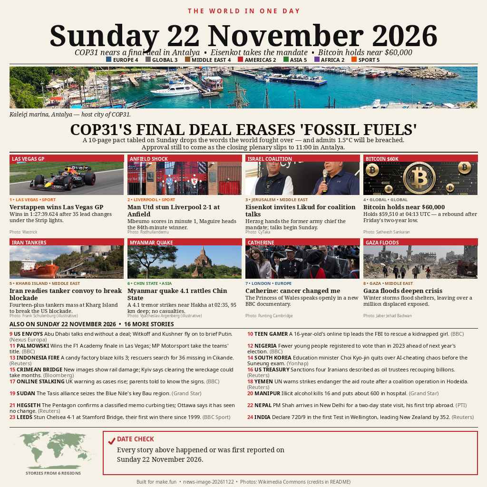

# Sunday 22 November 2026 — The World in One Day (Newspaper Front Page)

Entry for the make.fun competition
[news-image-20261122](https://make.fun/bounty/news-image-20261122):
"Sum up 22 November's world news in one image".

## The image

A newspaper front page in the style of the winning 21 November round 3
entry: cream paper, black serif type, red label bars, and the date —
"Sunday 22 November 2026" — as the huge masthead headline, with an italic
deck naming the three top stories. Below it, a banner photo of Antalya's
Kaleiçi marina (host city of COP31) with the cover headline, then 24
numbered stories with region tags across 7 regions, a red-bordered DATE
CHECK box, and a small sage-green world map in the bottom-left corner
showing the day's global coverage. Bright, attention-grabbing palette;
legible at ~300px.

Every story below happened or was first reported on Sunday 22 November
2026 (any time zone), verified against wire reporting. The cover story is
COP31: the final text ("Antalya Accords") was tabled in the early hours
of Sunday — a 10-page pact that never once mentions "fossil fuels",
"oil", "coal" or "phase out", and is the first COP text to admit peak
warming will exceed 1.5°C. The closing plenary was still deciding when
this was built (approval slipped to 11:00 in Antalya), so the cover says
the deal "erases" fossil fuels from the text — not that it was adopted.
Bitcoin is framed as a rebound (about $59,500 on Sunday after Friday's
two-year low of $55,130), not a new low.

Stories deliberately NOT used (they are not 22 November news): the
capture of "El Chapo Isidro" (operation 20 Nov, announced 21 Nov), the
FBI NCIC database hack (first reported 20 Nov), the Gaza four-nation aid
call (15 Nov), the Norway oil-licence ruling (13 Nov), the Al-Shabaab
ambush claim (October), the Venezuela $12bn report (12 Nov), the UN
autonomous-weapons talks (concluded 21 Nov), the Denmark expulsion of a
Russian attaché (20 Nov), the Kenya Ebola discharge (11 Nov), the Ghana
banknotes (12 Nov), the France protests and presidential debate (earlier
in November), and the Peru quake (21 Nov).

## Stories (cover + 24)

**Cover — COP31 nears a final deal (Antalya) — GLOBAL**
Final text tabled early Sunday; 10 pages, 94 paragraphs; first COP text
to admit 1.5°C will be breached. (Reuters, AP, The Guardian)

1. Verstappen wins Las Vegas GP — SPORT (1:27:39.624, 35 lead changes)
2. Man Utd stun Liverpool 2-1 at Anfield — SPORT (Pochettino's first game; Mbeumo 1', Maguire 84')
3. Eisenkot invites Likud for coalition talks — MIDDLE EAST (Herzog hands the former army chief the mandate)
4. Bitcoin holds near $60,000 — GLOBAL ($59,510 at 04:13 UTC, Finnhub/Binance — a rebound, not a new low)
5. US envoys to Moscow and Dublin — EUROPE (Abu Dhabi talks end; Witkoff and Kushner travel on Sunday)
6. Iran readies tanker convoy to break blockade — MIDDLE EAST (14+ tankers at Kharg Island)
7. Myanmar quake 4.1 rattles Chin State — ASIA (02:35 near Hakha, 95 km deep; no casualties)
8. Catherine: cancer changed me — EUROPE (Princess of Wales in a new BBC documentary)
9. Teen gamer helps FBI rescue girl — AMERICAS (16-year-old Landon Tresp's online tip leads to a kidnapping rescue)
10. Palmowski wins F1 Academy finale — SPORT (final race in Las Vegas)
11. Nigeria's youth shun the vote — AFRICA (fewer young people registered than in 2023)
12. Gaza floods deepen crisis — MIDDLE EAST (winter storms flood shelters; over a million displaced exposed)
13. Indonesia factory fire kills 3, 36 missing — ASIA (confectionery factory fire in Cikande, Banten)
14. South Korea education minister resigns — ASIA (resignation accepted by the presidential office)
15. New images show Crimean Bridge rail damage — EUROPE (Ukraine's strikes on the Kerch Bridge)
16. US Treasury targets Iranian oil trustees — GLOBAL (sanctions on trustees of Iranian oil)
17. Parents told to spot online stalking signs — EUROPE (UK warning as cases rise)
18. UN warns Yemen strikes endanger aid route — MIDDLE EAST (Houthi strikes after a coalition operation in Hodeida)
19. Sudan's Tasis alliance claims Bau — AFRICA (seizes the Blue Nile's key Bau region)
20. Manipur liquor toll rises to 16 — ASIA (illicit alcohol; ~600 in hospital)
21. Hegseth restricts U.S.-Canada defense ties — AMERICAS (secret memo curbs military cooperation)
22. Nepal PM Shah begins state visit to India — ASIA (two-day visit, talks with Modi)
23. Leeds stun Chelsea 4-1 — SPORT (first win at Stamford Bridge since 1999)
24. India declare 720/9, lead NZ by 352 — SPORT (first Test, Wellington)

Regions: Europe 4, Global 3, Middle East 4, Americas 2, Asia 5, Africa 2, Sport 5 (25 stories incl. cover).

## Photos

All photos are from Wikimedia Commons, freely licensed. The tanker and
Myanmar photos are illustrative (a generic oil tanker; a Bagan landscape)
rather than the specific event; the Eisenkot photo is a 2022 portrait of
the person the story is about.

- Banner (Kaleiçi marina, Antalya): "Antalya kaleiçi 2.jpg", CC BY-SA 4.0, REHBER0770
- Verstappen: "Max Verstappen 2022.jpg", CC BY-SA 4.0, Wastrick
- Man Utd / Anfield: "Paisley Gateway, Anfield.jpg", CC BY-SA 4.0, Rodhullandemu
- Eisenkot: "Doron Amir and Gadi Eisenkot at the Cyber Negev competition 2022-04-05.jpg", CC BY-SA 4.0, CyTaka company employee
- Bitcoin: "Bitcoin BTC golden coin with the symbol.jpg", CC BY-SA 2.0, Satheesh Sankaran
- Iran tanker (illustrative): "Tanker Sten Suomi at a fuel depot in Stockholm.jpg", CC BY-SA 4.0, Frank Schulenburg
- Myanmar (illustrative): "Bagan, Myanmar, Landscape with Sulamani Temple seen from afar.jpg", CC BY 4.0, Vyacheslav Argenberg
- Gaza floods: "Forced Displacement of Gaza Strip Residents During the Gaza-Israel War 23-25.jpg", CC BY-SA 4.0, Jaber Jehad Badwan
- Catherine: "Duchess of Cambridge, Catherine Middleton, Market Square Cambridge.jpg", CC BY-SA 2.0, Punting Cambridge
- World map (bottom-left): "BlankMap-World.png", public domain, Vardion

## How it is built

`render.py` (Pillow, local only) draws the front page and writes
`entry.png` (1024×1024, ≤1 MiB, deterministic). `main.py` is standard
library only and copies `entry.png` to `$MAKEFUN_OUTPUT_DIR/entry.png`;
it runs twice with byte-identical output.

Made for the make.fun bounty. Referral code: `5t0n7vxw`.
